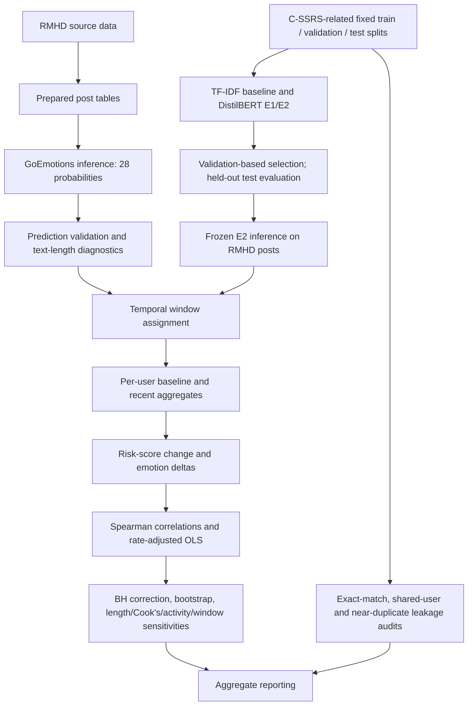

# METHODOLOGY.md — Temporal Behavioral Analysis for Mental Health Risk Detection

## 1. Scope and research question

This project explores whether within-user changes in model-estimated emotion scores in timestamped Reddit text are associated with changes in a separately model-estimated text risk score. It also evaluates a six-class text classifier trained on a C-SSRS-related Reddit dataset and audits its split integrity.

**Research question.** Among users meeting the project's posting-history requirements, are recent-minus-baseline changes in GoEmotions model outputs associated with recent-minus-baseline changes in a C-SSRS-related classifier's `behavior` plus `attempt` probabilities?

**Objectives**

1. Generate 28 GoEmotions probability scores for each prepared RMHD post.
2. Validate prediction coverage, probability ranges, metadata alignment, token truncation, temporal stability, and distributional properties.
3. Train and compare text classifiers using fixed train/validation/test parquet splits; select checkpoints using validation data and report test performance separately.
4. Construct per-user baseline and recent windows and calculate within-user changes in emotion and risk model outputs.
5. Test associations using rank correlations and a rate-adjusted multivariable OLS model, with multiple-testing correction and sensitivity analyses.
6. Audit potential train/validation/test leakage and document limitations.

This is exploratory NLP research, not a clinical instrument. Model outputs are not observed mental-health states, diagnoses, clinical outcomes, or validated predictions of future behavior. Do not use scores or derived categories to diagnose, label, rank, or make consequential decisions about individuals.

## 2. Pipeline overview

The current cleaned notebook contains 244 cells; the older project notebook and `NLP(1).ipynb` contain earlier workflows. The project workflow used local preprocessing in VS Code, followed by copying prepared CSV files to Google Drive for Colab. The current public repository contains the Colab notebook and documentation, but the standalone VS Code preprocessing script(s) are not present in the files inspected for this documentation update. Therefore, the handoff from raw RMHD download to the exact current prepared CSVs is not independently reproducible from this repository alone. The older `NLP(1).ipynb` is useful evidence of earlier downstream processing, but it uses a different cohort/scoring design and must not be treated as the authoritative recipe for the current 680-author analysis. The repository also does not include all datasets, checkpoints, intermediate predictions, or user-level tables.

## 3. Data sources and cohort flow

### 3.1 Sources

- **Reddit Mental Health Dataset (RMHD):** https://zenodo.org/records/3941387 — time-stamped Reddit material used for temporal analyses.
- **Reddit C-SSRS Suicide Dataset:** https://zenodo.org/records/2667859 — labeled text records used for the six-class classifier workflow. This is a research dataset; the project does not administer the clinical C-SSRS instrument.
- **GoEmotions dataset/paper:** https://github.com/google-research/google-research/tree/master/goemotions and https://arxiv.org/abs/2005.00547. The notebook also references the Hugging Face dataset `google-research-datasets/go_emotions` with the `simplified` configuration in evaluation-related cells.

Dataset licences, version identifiers, access conditions, and citations must be checked against the exact versions downloaded. The notebook does not provide a fully pinned data snapshot.

### 3.2 Cohort counts

| Stage | Count recorded in notebook/project outputs | Meaning / qualification |
|---|---:|---|
| Prepared RMHD emotion input | 83,516 posts | Input/prediction validation asserts 83,516 rows and unique `post_id` values. This is not a verified raw-source count. |
| Distinct authors in the prepared RMHD corpus | 680 users | Recorded project cohort before temporal eligibility. |
| Temporal eligible cohort | 258 users | Users satisfying the primary recent/baseline post-count thresholds. |
| Posts associated with temporal cohort | 16,639 posts | Recorded temporal subset. |
| Users not in primary temporal cohort | 422 users | Difference between 680 recorded users and 258 eligible users; exclusion reasons should be verified against the saved eligibility audit. |
| Raw source posts before cleaning | Not reported | The current notebook starts from prepared CSVs, so it does not establish the raw-source count. |
| Rows after each cleaning/filtering step | Not reported | A complete stage-by-stage row-count ledger is not part of the current notebook. |
| Authors selected into the 680-user subset | 680 distinct authors in the prepared corpus | The current notebook confirms this corpus-level count, but does not document the upstream selection rule. |

Do not present the 83,516 prepared posts as the raw dataset size. It is the recorded size of the prepared emotion-input/prediction corpus. The 680-user and 258-user counts are dataset-specific, not representative population estimates.

### 3.3 Preparation, filtering, and text construction

The notebook consumes these prepared files:

| File | Known columns | Role |
|---|---|---|
| `data/processed/rmhd_680_clean.csv` | `author`, `created_utc`, `score`, `selftext`, `subreddit`, `title`, `timestamp` | Prepared RMHD table. |
| `data/processed/rmhd_emotion_input.csv` | `post_id`, `author`, `created_utc`, `score`, `selftext`, `subreddit`, `title`, `timestamp`, `text` | Input table for GoEmotions inference; `post_id` is asserted unique and `text` is passed to the model. |

The notebook parses `timestamp` with `pd.to_datetime(..., errors="coerce", utc=True)` in integrity/temporal cells and reports invalid timestamps. The GoEmotions input check asserts that `post_id` and `text` exist and that `post_id` is unique. Checkpoint export deduplicates predictions on `post_id`, keeping the last checkpoint row, then sorts by `post_id`.

The project workflow, as recalled and described by the author, was: run preprocessing scripts locally in VS Code, create prepared CSV files, copy those files into Google Drive, then execute the Colab analysis. The current cleaned notebook consumes the prepared CSVs; it does not itself provide a complete raw-download-to-CSV preparation stage. The legacy `NLP(1).ipynb` documents downstream operations on existing files (including loading `rmhd_688_selected.csv`, reading timestamps, and generating downstream temporal features), but it does not prove the exact transformation that created the current `rmhd_680_clean.csv` and `rmhd_emotion_input.csv`. No standalone VS Code `.py` preparation script was available among the project files inspected for this documentation update. Accordingly, the local-to-Drive handoff is documented, but exact raw-data filters, missing-value rules, deduplication, author-selection logic, and text-construction details are not asserted unless supported by the current notebook or the script itself. To make raw-to-prepared reproduction complete, add the actual script(s) to the repository after checking them against the current 680-author outputs.

## 4. Emotion inference

### Model and labels

- Model identifier: `SamLowe/roberta-base-go_emotions`.
- The notebook loads `AutoTokenizer` and `AutoModelForSequenceClassification` from Transformers.
- The model exposes 28 labels: 27 emotion labels plus `neutral`. The notebook creates columns named `emotion_<label>` from `model.config.id2label` and asserts 28 output columns.
- Inference converts logits to probabilities using `torch.sigmoid(logits)`, not a softmax across mutually exclusive classes. These are multi-label model scores.

### Inference settings

| Setting | Value |
|---|---:|
| Batch size | 32 |
| Checkpoint chunk size | 1,000 pending posts |
| Maximum token length | 512 |
| Padding | Batch padding enabled |
| Truncation | Enabled |
| Device | CUDA when available; otherwise CPU |
| Inference mode | `torch.inference_mode()` |
| Alignment verification sample | 200 posts, `random_state=42` |

The notebook resumes inference by collecting already processed `post_id` values from `checkpoint_*.csv`. It exports combined predictions to `results/predictions/goemotions/rmhd_goemotions_predictions.csv`. Prediction validation checks expected row count, unique post IDs, 28 emotion columns, and finite probabilities in `[0,1]`. No universal probability threshold is applied to all emotion outputs; temporal analysis uses continuous probability scores.

### Aggregation

For each eligible author and each temporal window, the notebook aggregates post-level emotion probability columns to window-level means, then computes recent-minus-baseline deltas. The principal feature table is `results/temporal_features_90d_180d.csv`; the post-assigned dataset is `results/post_level_temporal_90d_180d.csv`. Both contain individual-level or post-linked information and should remain private.

## 5. C-SSRS-related risk classifier

### Categories and fixed splits

The notebook uses six labels: `attempt`, `behavior`, `ideation`, `indicator`, `supportive`, and `uninformative`. The fixed parquet files are:

- `data/CSSRS/Copy of cssrs_train.parquet`
- `data/CSSRS/Copy of cssrs_val.parquet`
- `data/CSSRS/Copy of cssrs_test.parquet`

Recorded split sizes are train 1,815, validation 482, and test 443, total 2,740. The notebook reads the existing split files rather than creating a new split in the final E2 path. Label IDs are fitted from training labels and checked against validation/test labels. Test data is described as held out and is used for final evaluation, not model selection.

### Models and training settings

**E0 — TF-IDF + Logistic Regression baseline:** TF-IDF lowercasing, Unicode accent stripping, unigrams and bigrams, `min_df=2`, `max_features=100000`, `sublinear_tf=True`; logistic regression `max_iter=2000`, `random_state=42`, `class_weight=None`; candidate `C` values `[0.1, 1.0, 10.0]`; choose by validation macro-F1. TF-IDF is fitted on training data only.

**E1 — DistilBERT baseline:** `distilbert-base-uncased`; maximum length 256; truncation enabled; dynamic padding via `DataCollatorWithPadding`; seed/data seed 42; batch size 8; evaluation batch size 16; maximum 8 epochs; learning rate `2e-5`; weight decay `0.01`; warmup steps set to 10% of planned steps; FP16 enabled; validation each epoch; save each epoch; early stopping patience 2; select best validation macro-F1 and load best checkpoint at end.

**E2 — class-weighted DistilBERT:** same base model, sequence length, seed, batch sizes, maximum epochs, learning rate, validation-based selection approach, and early stopping family as E1. Class weights are square-root inverse-frequency weights derived from training-set class counts and normalized by a count-weighted average. E2 is the classifier used for the downstream RMHD risk-score analysis. Exact final checkpoint provenance should be recorded when reproducing.

Some later E2 evaluation/inference cells use a maximum length of 256, while the separate GoEmotions inference path uses 512. These limits apply to different models/workflows and should not be conflated.

### Test performance

The recorded E2 test results are based on 443 posts:

| Metric | Result |
|---|---:|
| Accuracy | 0.6388 |
| Macro-F1 | 0.5079 |
| Weighted-F1 | 0.6231 |

Per-class results recorded in the notebook:

| Class | Precision | Recall | F1 | Support |
|---|---:|---:|---:|---:|
| attempt | 1.0000 | 0.3000 | 0.4615 | 10 |
| behavior | 1.0000 | 0.1364 | 0.2400 | 22 |
| ideation | 0.5763 | 0.5965 | 0.5862 | 57 |
| indicator | 0.4133 | 0.5000 | 0.4526 | 62 |
| supportive | 0.7090 | 0.8398 | 0.7689 | 206 |
| uninformative | 0.6610 | 0.4535 | 0.5379 | 86 |

Confusion-matrix rows are actual classes and columns are predicted classes in the order `attempt`, `behavior`, `ideation`, `indicator`, `supportive`, `uninformative`:

| Actual \ Predicted | attempt | behavior | ideation | indicator | supportive | uninformative |
|---|---:|---:|---:|---:|---:|---:|
| attempt | 3 | 0 | 4 | 2 | 1 | 0 |
| behavior | 0 | 3 | 5 | 10 | 2 | 2 |
| ideation | 0 | 0 | 34 | 11 | 12 | 0 |
| indicator | 0 | 0 | 7 | 31 | 17 | 7 |
| supportive | 0 | 0 | 8 | 14 | 173 | 11 |
| uninformative | 0 | 0 | 1 | 7 | 39 | 39 |

For the binary grouping `attempt` + `behavior`, the recorded test output reports 32 actual high-risk-class examples and 6 predicted high-risk examples, precision 1.0000, recall 0.1875, and F1 0.3158. This illustrates the important limitation that high precision at the default predicted labels coexists with low recall for these minority classes. The model should not be treated as a screening or alerting system.

## 6. Risk-score definition

For post *i*, the E2 score used in the temporal risk analysis is:

`risk_score_i = P_i(behavior) + P_i(attempt)`

The score is derived from the two class probabilities output by the six-class classifier. It is a model-derived text score, not an observed event, clinical assessment, calibrated probability of future behavior, or estimate of an individual's actual mental-health state. The two probabilities are summed as specified by the project; the result should not be interpreted as a validated clinical scale.

## 7. Temporal design and change features

### Primary window specification

| Parameter | Primary value |
|---|---:|
| Anchor | Each user's latest observed post |
| Recent window | `[0, 90)` days relative to anchor |
| Baseline window | `[90, 270)` days before anchor (180-day baseline) |
| Minimum recent posts | 5 |
| Minimum baseline posts | 15 |
| Strict sensitivity | At least 8 recent and 20 baseline posts |
| Alternative-window sensitivity | 60-day recent window and preceding 120-day baseline |

The frozen configuration records 90/180-day windows and the primary/strict thresholds. The temporal feature code parses timestamps as UTC and builds per-user window assignments. The current notebook has a boundary-expression inconsistency across temporal cells; the intended design is documented here, but exact edge inclusion should be interpreted from the executed feature-building cell when reproducing. The recorded eligible population is 258 users and 16,639 posts; 422 of the 680 users in the prepared cohort are not included in the primary temporal cohort.

**Boundary convention caution:** one notebook cell describes intervals as `[0,90)` and `[90,270)`, while another code path has a start/anchor comparison expressed with `>` and `<=`. Verify the precise inclusion of a post exactly at the anchor or interval boundary before claiming a bit-for-bit rerun. Do not silently resolve this discrepancy in prose.

For each emotion, the main change feature is:

`delta_emotion = mean(recent emotion probability) - mean(baseline emotion probability)`

For risk, the main outcome is the analogous recent-minus-baseline change in the E2 risk score, recorded as `mean_risk_change`. Posting activity is adjusted using:

`relative_posting_rate_change = ((recent_posts / 90) - (baseline_posts / 180)) / (baseline_posts / 180)`

This normalizes the different window durations. Changes may reflect language, context, posting activity, sample composition, model error, or truncation as well as underlying changes in expression.

## 8. Statistical analysis and primary regression

### Emotion–risk correlations

The notebook computes Spearman correlations between each of the 28 emotion-delta features and `mean_risk_change`, then applies Benjamini–Hochberg false-discovery-rate correction across the tested emotion family. Six of 28 associations were recorded as significant after correction:

| Emotion delta | Spearman rho | BH-adjusted p |
|---|---:|---:|
| nervousness | +0.2628 | 0.0005 |
| fear | +0.2428 | 0.0011 |
| disappointment | +0.2141 | 0.0050 |
| neutral | -0.2046 | 0.0066 |
| embarrassment | +0.1980 | 0.0078 |
| curiosity | -0.1704 | 0.0283 |

These are associations between changes in model outputs, not evidence that emotions cause risk-score changes or that either output measures clinical status.

### Primary multivariable model

The primary rate-adjusted model is ordinary least squares with HC3 heteroskedasticity-robust standard errors. Outcome: `mean_risk_change`. Predictors: six emotion changes (`delta_disappointment`, `delta_fear`, `delta_nervousness`, `delta_curiosity`, `delta_embarrassment`, `delta_neutral`) plus `relative_posting_rate_change`. Benjamini–Hochberg adjustment is applied across the seven predictor p-values.

Recorded model summary: `n=258`, R² = 0.1622, adjusted R² = 0.1388, overall model p = 1.56946e-07 in the project result record.

| Predictor | Coefficient | HC3 SE | 95% CI lower | 95% CI upper | p-value | BH-adjusted p |
|---|---:|---:|---:|---:|---:|---:|
| delta_disappointment | 0.42338 | 0.11905 | 0.18891 | 0.65785 | 0.000450 | 0.00315 |
| delta_fear | 0.29658 | 0.1559 | -0.0104 | 0.6036 | 0.05824 | 0.20385 |
| delta_nervousness | 0.20398 | 0.1388 | -0.0693 | 0.4773 | 0.14281 | 0.29727 |
| delta_curiosity | -0.17027 | 0.1316 | -0.4294 | 0.0889 | 0.19689 | 0.29727 |
| delta_neutral | -0.10366 | 0.0869 | -0.2748 | 0.0674 | 0.23387 | 0.29727 |
| delta_embarrassment | 0.44335 | 0.3884 | -0.3217 | 1.2084 | 0.25481 | 0.29727 |
| relative_posting_rate_change | -0.00356 | 0.0049 | -0.0132 | 0.0061 | 0.46759 | 0.46759 |

**Main finding, cautiously stated:** in this exploratory multivariable analysis, disappointment-score change was positively associated with the change in the model-derived risk score after adjustment for the six emotion changes and relative posting-rate change (coefficient 0.42338, BH-adjusted p approximately 0.00315). This does not establish causation, clinical validity, or individual predictive utility.

### Robustness and uncertainty

- **Length-adjusted regression:** adds `delta_mean_tokens` to the seven predictors. Recorded disappointment coefficient 0.40042, 95% CI [0.16396, 0.63688], p=0.00090, BH-adjusted p=0.00723. This supports robustness to this specific length adjustment only.
- **Cook's-distance sensitivity:** threshold `4/n`; 25 of 258 observations excluded, leaving 233. The excluded-observation model changes coefficients/significance, so it is a sensitivity analysis, not a replacement for the prespecified full-sample model.
- **Bootstrap:** user-level row resampling with replacement, 5,000 requested draws and NumPy seed `20261019`. Recorded 95% percentile intervals include disappointment coefficient [0.19509, 0.64668]. Confirm successful completion and finite draw counts before reusing all intervals.
- **Posting-activity sensitivity:** a subset of 170 users meeting at least 10 posts in both windows was examined; recorded mean risk-score change -0.0134 and median -0.0122. This is a sensitivity cohort, not the primary cohort.
- **Window/eligibility sensitivity:** strict thresholds 8 recent/20 baseline; alternative 60/120-day windows; and exclusion of users with at least 10% truncated posts are included.

## 9. Data-quality, stability, and leakage checks

### Emotion and temporal quality checks

The notebook includes checks for unique post IDs, prediction row coverage, finite probabilities in `[0,1]`, metadata alignment, invalid timestamps, per-user history coverage, text truncation, emotion distributions/correlations, within- and between-user variability, intraclass correlation, temporal baseline stability, shuffled-baseline comparisons, subreddit metadata quality, monthly drift, window coverage, feature-table eligibility, and statistical null calibration. These diagnostics are not clinical validation.

Recorded text-length diagnostics: 16,639 posts in the temporal subset; median length 53 words / 68 tokens; 674 posts above 512 tokens (4.05%). Token count had a recorded post-level Spearman association with E2 risk score of approximately 0.35507; user-level token-count change correlated with risk-score change at approximately 0.20907 (p≈0.00073). These associations indicate a possible measurement confound, not that length causes risk.

### Cross-split leakage audit

The notebook checks C-SSRS train/validation/test splits for duplicate post IDs, duplicate texts, missing text/labels, normalized exact-text overlap, shared users, and near-duplicate candidate pairs using character-level TF-IDF/cosine similarity with threshold `>=0.85`. Recorded audit summary: no exact normalized cross-split matches, no shared users, and no near-duplicate candidate pairs above the configured threshold. These checks reduce concern about the specific tested overlap types; they do not prove the absence of every possible leakage route.

### RMHD/C-SSRS overlap and evaluation separation

The notebook also examines normalized text overlap between C-SSRS material and RMHD, text characteristics, and the use of frozen E2 predictions on RMHD. The held-out C-SSRS test split should not be used to select models or tune thresholds. Some analysis cells inspect validation ranking and fixed top-30 prioritization, but these do not validate the model as an alerting system.

### Note on the earlier NLP notebook

The attached legacy `NLP(1).ipynb` is useful historical context, but it represents an earlier version of the project. It records an older cohort check of 83,895 posts and 688 users and contains an 80/20 chronological per-user split, component-weighted temporal scoring, and watch/moderate/high thresholds. The current cleaned notebook instead documents 83,516 prepared posts, 680 authors, a 90-day recent / 180-day baseline design, and a model-derived E2 risk score defined as `P(behavior) + P(attempt)`. The legacy cohort counts and weighted composite score are therefore not used as current-project results and are not merged into the current methodology.

## 10. Design choices and rationale

- **90-day recent / 180-day baseline:** fixed in the analysis configuration to compare a shorter recent period with a longer historical reference while retaining a common anchor. Alternative 60/120-day windows are a sensitivity analysis, not evidence that one window is optimal.
- **Minimum 5 recent / 15 baseline posts:** ensures a minimum number of observations in each window; stricter 8/20 thresholds check dependence on eligibility. These thresholds are design choices, not validated clinical cut-offs.
- **Sum of `behavior` and `attempt` probabilities:** reflects the project's operational definition for a continuous risk-related score. It is not a clinically validated scale.
- **DistilBERT E2 class weighting:** square-root inverse-frequency weights were introduced to address underrepresented classes; minority-class recall remains low, so this does not eliminate imbalance concerns.
- **Continuous emotion probabilities and mean deltas:** preserve more information than binary emotion flags and allow within-user comparisons, but remain dependent on the pretrained model's behavior.
- **BH correction, HC3 errors, bootstrap and sensitivity analyses:** address multiple testing, heteroskedasticity, and selected robustness concerns. They do not remedy selection bias, model misspecification, or lack of external validation.

## 11. Limitations and ethics

1. **Model error and class imbalance:** E2 has low recall for `behavior` (0.1364) and `attempt` (0.3000); weighted and overall metrics obscure minority-class performance.
2. **Construct validity:** emotion probabilities and the risk score are model outputs, not verified emotional states or clinical outcomes.
3. **Sampling bias:** Reddit users and posts are self-selected; the 680-user corpus and 258-user temporal subset are not representative population samples.
4. **Platform/language effects:** slang, irony, context, subreddit norms, language variety, and changes in platform behavior may alter model scores.
5. **Temporal confounding:** posting activity, text length/truncation, time, and changes in who posts can affect results. The current covariates do not remove all confounding.
6. **Causality:** correlations and OLS coefficients are observational associations, not causal effects.
7. **Leakage audit scope:** no detected exact/near duplicates is limited to the specific normalization, similarity threshold, and identifiers tested.
8. **Reproducibility:** source data versions, package versions, full preprocessing provenance, some null-test iteration settings, and final checkpoint hashes are not all pinned in the notebook.
9. **Privacy:** do not publish raw posts, author identifiers, post IDs, per-post predictions, per-user temporal features, user-level risk indicators, or audit rows. Aggregate CSVs also require a full content review before public release.
10. **No individual-level use:** do not deploy this workflow for surveillance, triage, diagnosis, ranking, employment/education decisions, or other consequential individual decisions.

## 12. Future work

- Recover and publish the exact preprocessing code, with stage-by-stage row counts and a synthetic test fixture.
- Pin package versions, dataset revisions, model revisions, checkpoint hashes, and random seeds; test the full pipeline from a clean environment.
- Improve minority-class evaluation with class-wise calibration, error analysis, and independent external evaluation while keeping test data untouched during selection.
- Evaluate temporal stability and language/subreddit/domain shifts on independently sourced data with appropriate governance.
- Pre-register primary hypotheses and analysis choices; clearly separate confirmatory from exploratory results.
- Investigate posting activity and text length as measurement/confounding factors, and document missingness and eligibility effects.
- Conduct a privacy/ethics review before sharing any derived data, including aggregate disclosure risk.

## 13. References

- Reddit Mental Health Dataset (RMHD), Zenodo record: https://zenodo.org/records/3941387
- Reddit C-SSRS Suicide Dataset, Zenodo record: https://zenodo.org/records/2667859
- Demszky, D. et al. (2020). *GoEmotions: A Dataset of Fine-Grained Emotions*. https://arxiv.org/abs/2005.00547
- Google Research GoEmotions repository: https://github.com/google-research/google-research/tree/master/goemotions
- GoEmotions Hugging Face dataset: https://huggingface.co/datasets/google-research-datasets/go_emotions
- GoEmotions model card: https://huggingface.co/SamLowe/roberta-base-go_emotions
- DistilBERT base model: https://huggingface.co/distilbert/distilbert-base-uncased
- C-SSRS instrument background (context only; distinct from the Reddit dataset): https://cssrs.columbia.edu/the-columbia-scale-c-ssrs/cssrs-for-research/
- Hugging Face Transformers: https://huggingface.co/docs/transformers
- Hugging Face Datasets: https://huggingface.co/docs/datasets
- PyTorch: https://pytorch.org/docs/stable/
- scikit-learn: https://scikit-learn.org/stable/
- pandas: https://pandas.pydata.org/docs/
- SciPy: https://docs.scipy.org/doc/scipy/
- statsmodels: https://www.statsmodels.org/stable/

Exact package versions are not pinned by the notebook. Cite the installed versions recorded in a reproduction environment rather than implying a fixed tested environment.

## 14. Appendix: data dictionary

This dictionary describes known schemas from notebook references and recorded project inventory. Some schemas must be verified against the actual files because those files are not all in the public repository. No row-level examples are reproduced here.

### Prepared data

| File / table | Column | Meaning |
|---|---|---|
| `rmhd_680_clean.csv` | `author` | Reddit author identifier; sensitive/linkable; do not publish. |
| | `created_utc` | Source creation-time field; exact unit/type must be verified. |
| | `score` | Reddit post score field. |
| | `selftext` | Post body text; raw user content. |
| | `subreddit` | Subreddit/community metadata. |
| | `title` | Post title text. |
| | `timestamp` | Parsed/normalized timestamp used for temporal analysis; exact preparation provenance requires verification. |
| `rmhd_emotion_input.csv` | `post_id` | Post identifier used for prediction alignment; do not publish. |
| | `author` | Author identifier; do not publish. |
| | `created_utc` | Source creation-time field. |
| | `score` | Reddit post score. |
| | `selftext` | Post body text. |
| | `subreddit` | Subreddit metadata. |
| | `title` | Post title. |
| | `timestamp` | Timestamp used for temporal windows. |
| | `text` | Consolidated text passed to the emotion model. Its exact upstream title/body construction is not defined in the current notebook, so the documentation does not assume a concatenation rule. |

### GoEmotions prediction and temporal tables

| File / table | Column(s) | Meaning |
|---|---|---|
| `rmhd_goemotions_predictions.csv` | `post_id`, `author`, `timestamp`, `created_utc`, `subreddit`, `score` (where present) | Metadata carried with each post's predictions; identifiers and linkage fields are private. |
| | `emotion_<label>` (28 columns) | Sigmoid probabilities for the model's 27 emotion labels plus `neutral`; exact suffixes are created from the loaded model's `id2label`. |
| `temporal_features_90d_180d.csv` | `author` | User key; private. |
| | `recent_posts`, `baseline_posts` | Post counts in the recent and baseline windows. |
| | `baseline_<label>` | Mean emotion probability for that label in the baseline window. |
| | `recent_<label>` | Mean emotion probability for that label in the recent window. |
| | `delta_<label>` | `recent_<label> - baseline_<label>`. |
| `post_level_temporal_90d_180d.csv` | `post_id`, `author`, timestamp/window/anchor fields | Post assignment and temporal linkage; exact complete columns should be verified from the file. Keep private. |
| | emotion probability fields | Post-level model scores carried into temporal analysis. |
| `temporal_population_emotion_tests.csv` and sensitivity variants | `emotion` | Emotion feature tested. |
| | `mean_change`, `median_change` | Summary of recent-minus-baseline changes. |
| | p-value / confidence interval / q-value fields | Inferential statistics; exact field spellings differ across sensitivity outputs and should be read from each CSV header. |

### Classifier inputs and outputs

| File / table | Column | Meaning |
|---|---|---|
| C-SSRS parquet splits | `post_id` | Dataset post identifier. |
| | `text` | Text supplied to the classifier. |
| | `risk_label` | One of six target categories: attempt, behavior, ideation, indicator, supportive, uninformative. |
| E2 prediction outputs | `post_id` | Post identifier for joining; private. |
| | `e2_prediction` | Predicted six-class label. |
| | `P_<class>` / probability fields (exact naming depends on output cell) | Model probability for a class; verify exact headers in the specific output. |
| | `high_risk_score` | Sum of `behavior` and `attempt` class probabilities in the documented risk-score output. |

### Combined user-level analysis table

`results/combined_temporal_behavioural_features.csv` is one row per author and must not be published as-is.

| Column | Meaning |
|---|---|
| `author` | User key; private. |
| `baseline_posts`, `recent_posts` | Counts of posts in baseline/recent windows. |
| `baseline_<emotion>`, `recent_<emotion>`, `delta_<emotion>` | Window means and recent-minus-baseline changes for emotion features. |
| `mean_baseline_risk`, `mean_recent_risk` (or corresponding exact saved names) | Mean E2 risk score in each window; verify exact names in the produced file. |
| `mean_risk_change` | Recent-minus-baseline mean E2 risk score; primary regression outcome. |
| `relative_posting_rate_change` | Difference in posts/day rates divided by baseline posts/day rate; computed in regression cells. |
| `delta_mean_tokens`, `delta_mean_words` | Recent-minus-baseline average text-length changes in the length sensitivity table; individual-level and private. |

### Aggregate reporting files

| File | Columns | Meaning / release note |
|---|---|---|
| `significant_temporal_emotion_summary.csv` | `Emotion`, `Mean change`, `Median change`, `Users with increase`, `Users with decrease` | Six-emotion descriptive summary in recorded output. Counts are aggregate but review for consistency and disclosure risk before publishing. |
| `consolidated_project_results.csv` | `Analysis`, `Result`, `Interpretation` | Compact summary of selected results. Review all text and statistics before publication; do not assume aggregate status alone guarantees safe release. |
| `multivariable_temporal_rate_adjusted_results.csv` | `Predictor`, `Coefficient`, `Robust_SE`, `p_value`, `CI_lower`, `CI_upper`, `p_adjusted_BH` | Primary seven-predictor regression results. Aggregate statistical output. |
| `multivariable_temporal_length_adjusted_results.csv` | `Predictor`, `Coefficient`, `Robust_SE`, `p_value`, `CI_lower`, `CI_upper`, `p_adjusted_BH` | Length-adjusted sensitivity regression. |
| `multivariable_temporal_cooks_excluded_BH_results.csv` | `feature`, `coefficient`, `HC3_robust_SE`, `HC3_robust_p_value`, `HC3_CI_lower`, `HC3_CI_upper`, `BH_adjusted_p_value` | Cook's-distance-excluded sensitivity regression. |
| `user_bootstrap_emotion_risk_correlations.csv` | `Emotion`, `Observed_Spearman_rho`, `bootstrap_draws`, `CI_2.5%`, `CI_97.5%` | User-resampling bootstrap intervals; aggregate results. |
| `user_bootstrap_disappointment_coefficient.csv` | `Predictor`, `Observed_coefficient_HC3`, `HC3_robust_SE`, `HC3_p_value`, `bootstrap_draws`, `CI_2.5%`, `CI_97.5%` | Bootstrap interval for disappointment coefficient. |

Other files such as `final_user_risk_indicator_summary.csv`, `exploratory_user_risk_indicators.csv`, `temporal_user_emotion_differences.csv`, `user_level_e2_temporal_risk_changes.csv`, `user_level_length_changes_diagnostic.csv`, `combined_temporal_behavioural_features.csv`, `temporal_features_90d_180d.csv`, `post_level_temporal_90d_180d.csv`, per-post predictions, and leakage audit tables can contain row-level or linkable information and should remain private. Exact schemas for files not included in the public repository must be verified against their headers before documenting them as exhaustive.

## Reproducibility handoff note (2026 documentation update)

The author reports that preprocessing was performed by running scripts in VS Code and then copying the generated CSV files to Google Drive for Colab. This workflow is reflected in the setup and workflow guides. The exact local script source is not included in the files available for this documentation pass, so the docs deliberately do not invent its transformations. Once the original scripts are committed, add their exact filenames, command lines, input/output schemas, and row-count checkpoints here. Do not upload raw Reddit text, author IDs, per-user tables, or other sensitive row-level outputs merely to make the repository appear self-contained.
