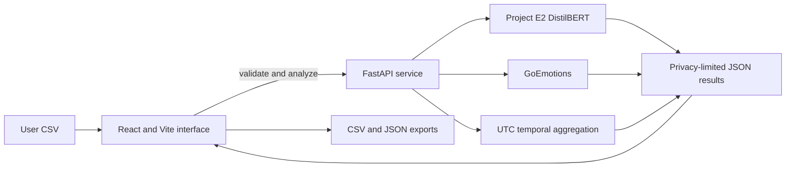

# Social Media Mental Health Risk Detection Using NLP and Temporal Analysis

An academic research demonstration with a React upload interface and a separate FastAPI inference service. It is not a mental-health diagnostic, screening, alerting, or decision-support tool. Model scores are uncalibrated estimates and do not represent clinical states or predict future behavior.

## Current implementation status

- The frontend has four sections: Home / Method, Analyze, Results, and Evaluation & Limitations.
- The Python API validates CSVs, counts exclusions and duplicate rows, handles timestamp parsing in UTC, computes cell 189 temporal eligibility, and runs E2 plus GoEmotions inference when both models are configured.
- A separate `/validate` request reports CSV counts, parsed timestamp range, and per-user temporal eligibility before inference; validation does not load or invoke models.
- The provided original E2 checkpoint is extracted locally at `backend/models/e2/best_model/` and excluded from Git. It contains the DistilBERT weights, config, tokenizer, and training-arguments file. The API validates the six expected labels and loads it using `AutoModelForSequenceClassification`.
- E2 training code in notebook cell 106 uses weighted `CrossEntropyLoss`, and later E2 evaluation uses six-class softmax. The API follows that documented single-label approach and reports all six class probabilities plus `P(behavior) + P(attempt)`.
- GoEmotions is pinned to immutable Hub revision `906933dcd4245e4f48d8a2ed585b036e2dd45f80` (the repository commit adding its license file). It downloads on first model load, so deployment needs outbound Hub access or a pre-populated cache.
- The supplied E2 checkpoint and pinned GoEmotions model have both passed real local API inference. A local CPU benchmark was completed; results and limits are recorded below. No deployment has been completed.
- Nothing has been deployed.

## Confirmed research details

The current notebook is `Google-Collab-notebook.ipynb` (244 cells). Cell 189 uses each user's latest valid timestamp as anchor, UTC parsing with invalid timestamps coerced, recent ages `[0, 90)` days, baseline ages `[90, 270)` days, and thresholds of 5 recent and 15 baseline posts. Its recorded audit reports 258 eligible users, matching the saved temporal population. Other notebook cells/docs mention boundary inconsistencies; this application follows cell 189's precise inequalities.

The recorded E2 score is `P(behavior) + P(attempt)` from six-class softmax outputs. The model's training configuration uses DistilBERT; notebook inference cells use max length 512. GoEmotions is `SamLowe/roberta-base-go_emotions`, with 28 independent sigmoid outputs. Those scores do not sum to one. Both models truncate at 512 tokens in this application.

The aggregate files under `results/` were inspected. `consolidated_project_results.csv` is a seven-row project summary with `Analysis`, `Result`, and `Interpretation`; `significant_temporal_emotion_summary.csv` has six emotion rows with means/medians and increase/decrease counts. They are summaries of the existing project dataset, not the user's upload, and are not rendered as new-run predictions.

The notebook/docs record E2 test results on 443 posts (accuracy 0.6388, macro-F1 0.5079, weighted-F1 0.6231). These are historical reported values, not independently reproduced against the original held-out split. The checkpoint is available locally but excluded from Git. Current uploaded data has not been evaluated. The original cohort filtering script, raw dataset, and exact complete text-construction provenance are not present.

## Architecture



## Repository layout

```text
backend/
  app/main.py                  FastAPI validation, temporal analysis, model inference
  models/e2/best_model/        Local original E2 checkpoint (ignored by Git; do not publish without rights review)
  tests/test_service.py        Validation and temporal unit tests
  requirements.txt             API and test dependencies
  Dockerfile                   Hugging Face Docker Space container
  README.md                    Space metadata/configuration
frontend/
  src/main.jsx                 Four-page React app and result exports
  src/style.css                Responsive interface styles
  package.json                 Vite/React dependencies
  vercel.json                  SPA rewrite
  .env.example                 Frontend API URL placeholder
results/                        Existing aggregate project summaries
Google-Collab-notebook.ipynb    Original research notebook (unchanged)
```

## CSV format and behavior

Upload a UTF-8 CSV with one post per row. The Analyze page lets you map a text column and optional user ID and timestamp columns. Current limits are 2 MiB and 100 rows; files above either limit are rejected without truncation. The row limit is conservative scaffolding, not a model benchmark-derived recommendation; it must be re-evaluated after real checkpoint inference on target hosting hardware.

- Empty or whitespace-only text is excluded from inference and counted.
- Duplicate full rows are counted and retained.
- Invalid timestamps are counted and excluded from temporal analysis; text can still receive post-level inference.
- Numeric epoch timestamps are not interpreted as dates. Use datetime strings.
- Missing user ID or timestamp allows post-level inference, without user timeline analysis.
- Temporal aggregation uses nonempty text rows with both a user ID and valid timestamp. Users need at least 5 recent and 15 baseline rows for an eligible comparison.
- Raw text is not returned in API responses or written to a results file. Returned user identifiers are randomly salted, run-specific pseudonyms. Do not treat pseudonymization as anonymization.
- Exports omit raw text. Row-level prediction files may still be sensitive; handle them accordingly.

## Local development

Python is needed only to run or self-host the Python API. The hosted frontend does not require users to install Python. Installing Python does not supply the model checkpoints.

### 1. Configure the model artifacts

The supplied ZIP has been extracted to `backend/models/e2/best_model/`, which is the default `E2_MODEL_PATH`. It includes all required files: `config.json`, `model.safetensors`, `tokenizer.json`, and `tokenizer_config.json` (plus `training_args.bin`). SHA-256 of the supplied weights: `b29aa9f24adb4b59b0505d23f74f5007e10eae5d1837e95bb46bfddaeead6071`. The API checks the exact label order: attempt, behavior, ideation, indicator, supportive, uninformative. The saved config leaves `problem_type` unset, so activation was determined from notebook cell 106: the custom trainer uses class-weighted `CrossEntropyLoss`, with class weights computed from square-root inverse-frequency counts. Training uses seed 42, batch size 8, up to 8 epochs, learning rate 2e-5, early-stopping patience 2, and weight decay 0.01; E2 evaluation cells use six-class softmax. The app follows that single-label softmax behavior. Preserve the checkpoint and do not commit it. Before transferring it to a public host, review its training-data and model redistribution terms.

GoEmotions is downloaded by Transformers from the public model repository when the service first loads the models. The default revision is pinned to `906933dcd4245e4f48d8a2ed585b036e2dd45f80`; first load needs outbound access and about 1 GB of available cache space. If offline, pre-populate the Hugging Face cache at this revision.

### 2. Run the API

From `backend/`:

```powershell
python -m venv .venv
.venv\Scripts\Activate.ps1
pip install -r requirements.txt
Copy-Item .env.example .env
uvicorn app.main:app --reload --host 127.0.0.1 --port 8000 --env-file .env
```

Check `http://127.0.0.1:8000/health`. The first `/analyze` request loads both models; GoEmotions needs network access on first load unless it is already in the Hugging Face cache. API docs are at `/docs` for local development.

### 3. Run the frontend

In another terminal, from `frontend/`:

```powershell
npm ci
Copy-Item .env.example .env.local
# Set VITE_API_URL=http://127.0.0.1:8000 in .env.local
npm run dev
```

Vite displays the local URL. For production builds, run `npm run build`.

## Tests and benchmarks

From `backend/`, run:

```powershell
pytest -q
```

The backend tests cover CSV validation, numeric/naive/timezone-aware timestamps, duplicate rows, empty text, temporal exact boundaries and thresholds, row and byte-size guards, malformed CSV payloads, missing-checkpoint loading, and genuine E2 checkpoint smoke inference. Frontend tests verify both CSV exports and JSON metadata, including exclusion of raw text. A live FastAPI check also verified health, CORS, CSV validation, and privacy-preserving predictions from both actual models. These checks do not reproduce the notebook evaluation metrics.

Full API CPU benchmark on the local machine: 3 requests per size, one cold request included at 10 posts, and median reported; 10 PyTorch CPU threads, batch size 8, synthetic text, both actual models loaded, and tokenization plus API/CSV work included in wall time. Results: 10 posts 0.402 s median API wall / 0.361 s model inference; 25 posts 0.928 / 0.880 s; 50 posts 2.071 / 1.992 s; 100 posts 5.093 / 4.981 s. The first cold 10-post request took 4.063 s including model startup. These are local measurements, not a hosting guarantee. Peak memory was not measured. A separate warm E2-only benchmark measured 0.164, 0.362, 0.682, and 1.387 seconds for 10/25/50/100 posts, respectively.

## Configuration

Backend variables are listed in `backend/.env.example`:

| Variable | Purpose |
|---|---|
| `E2_MODEL_PATH` | Local E2 directory; defaults to `backend/models/e2/best_model` |
| `E2_HF_MODEL_ID` | Optional Hub repository containing the original E2 checkpoint/tokenizer (instead of local path) |
| `E2_MODEL_REVISION` | Optional immutable revision for Hub-hosted E2 |
| `EMOTION_MODEL_ID` | GoEmotions model ID (default shown in the example) |
| `EMOTION_MODEL_REVISION` | Immutable GoEmotions revision; defaults to `906933dcd4245e4f48d8a2ed585b036e2dd45f80` |
| `HF_HOME` | Optional Hugging Face cache directory; `.env.example` uses `models/hf-cache` |
| `MAX_UPLOAD_BYTES` | Request CSV size ceiling (default 2 MiB) |
| `MAX_ROWS` | CSV row ceiling (default 100) |
| `INFERENCE_BATCH_SIZE` | CPU inference batch size (default 8) |
| `ALLOWED_ORIGINS` | Comma-separated exact frontend origins; set to production Vercel URL |
| `HF_TOKEN` | Optional backend-only access token for a private model repository |

Frontend `VITE_API_URL` is the public API base URL. It is not a secret. Never put model access tokens or other secrets in frontend variables or commit them. If model access requires authentication, use a host secret and backend-only access.

## Deployment

### Vercel frontend

1. Import the Git repository into Vercel after reviewing and pushing the project yourself.
2. Set the project Root Directory to `frontend`; Vercel detects Vite and uses `npm run build` with `dist` output.
3. In Vercel Project Settings → Environment Variables, set `VITE_API_URL` to the deployed Python API URL for Preview and Production. This is public frontend configuration, not a secret. Redeploy after changing it.
4. Deploy and add the final Vercel origin to the backend's `ALLOWED_ORIGINS`.
5. Redeploy the API after setting CORS, then verify `/health` and upload a small authorized test file.

### Python API

The `backend/Dockerfile` and Space configuration target a Hugging Face Docker Space on port 7860. Create a separate Docker Space and copy the contents of `backend/` (`Dockerfile`, `README.md`, `requirements.txt`, and `app/`) to the Space repository root. Set `E2_MODEL_PATH` to an authorized checkpoint path or `E2_HF_MODEL_ID` to an authorized Hub repository. For a private model, configure `HF_TOKEN` only as a Space secret and pin `E2_MODEL_REVISION`. Current Hugging Face documentation lists CPU Basic as 2 vCPU and 16 GB RAM, with inactivity sleep after 48 hours. It also says creating a Docker or Gradio Space running on compute requires a paid plan for personal accounts (static Spaces are free). Check current account requirements and pricing before creating a Space; no reliably free hosted Python API is established here.

Before deployment, make the authorized E2 checkpoint available to the service (for Docker, mount it at `/app/models/e2/best_model` or set `E2_MODEL_PATH`) or use an access-controlled Hub repository. Keep private weights in protected storage; do not commit checkpoints. The GoEmotions model card reports an MIT license; verify E2 checkpoint license and redistribution terms separately. Dataset terms for the exact versions are also unverified. Model load happens once per process on first inference; it downloads GoEmotions if it is not cached.

No service has been published or deployed from this repository. Account setup, model transfer, CORS origin, domain, and credentials must be supplied/configured by the owner.

## Privacy and limitations

Uploaded data is sent to the configured API service. Multipart parsing may temporarily spool a small upload to host-managed temporary storage. This prototype has no persistent result store, but transient memory, hosting logs, temporary storage, network handling, and host retention policies still matter; use only data you are authorized to process. The service does not include raw text in results. The user chooses CSVs and is responsible for authorization and safe handling of row-level exports.

The notebook reports an existing dataset of 680 users / 83,516 prepared posts and a cell 189 temporal audit of 258 eligible users. Those cohort counts do not describe arbitrary uploads. Generalization, clinical validity, calibration, and causal interpretation have not been established. Short and rare classes have documented evaluation limitations. The 512-token truncation can discard text. Different text construction and dataset populations can change model behavior.

The existing cohort selection criteria are documented as at least 50 posts per user and at least 365 days of observed timeline, but its original filtering script and raw dataset are missing. No reproduction claim is made. Historical aggregate output files remain summaries from the original project dataset and are not results from a user upload.

## Hosting sources checked

- [Hugging Face Spaces overview and hardware/lifecycle notes](https://huggingface.co/docs/hub/spaces-overview)
- [Hugging Face Spaces hardware and sleep documentation](https://huggingface.co/docs/hub/main/en/spaces-gpus)
- [Vercel Vite framework configuration](https://vercel.com/docs/frameworks/frontend/vite)

See [METHODOLOGY.md](METHODOLOGY.md), [SETUP_GUIDE.md](SETUP_GUIDE.md), and [WORKFLOW.md](WORKFLOW.md) for research provenance and the original analysis workflow.
